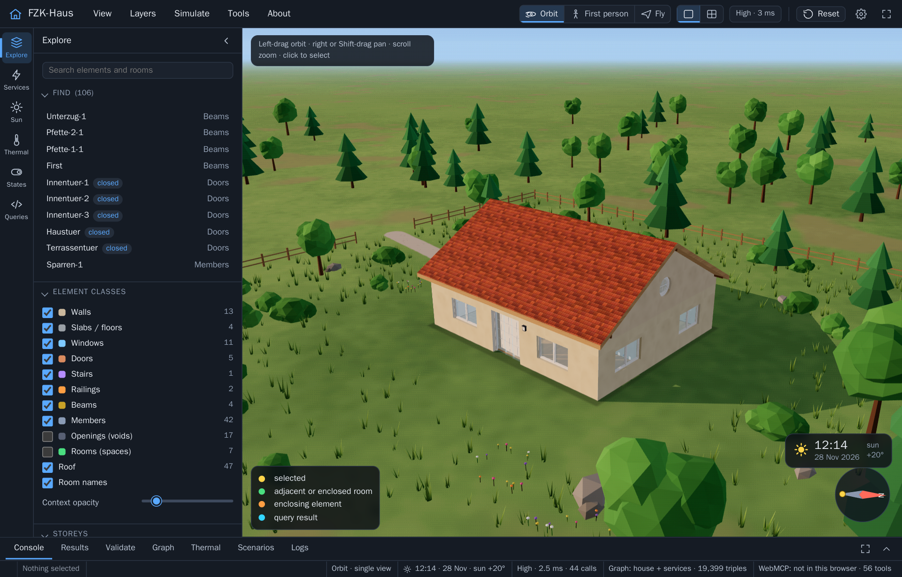

# FZK-Haus: a house as a 3D knowledge graph

**[▸ Open the house →](building.html)**

A small detached house you can orbit, cut, walk through and query. The walls,
doors and rooms come from a real IFC model. The wiring, pipes, heating and
structure on top are a design we made for it, kept as a second graph. Every
panel on the page reads those two graphs with SPARQL in the browser.

<figure class="fig-center">
  
  <figcaption>The house at the default hour. Menus at the top, panels on the left, the console and the other tabs at the bottom.</figcaption>
</figure>

## Two graphs

**The house.** AC20-FZK-Haus is an openly licensed IFC4 sample building
published by KIT. We parse it with [IfcOpenShell](https://ifcopenshell.org) and
write three layers of RDF:

- [BOT](https://w3id.org/bot) for the spatial breakdown: site, building,
  storey, space, element.
- `cad:` for the IFC specifics: class, material, which elements bound a room,
  which rooms are adjacent, which wall a window fills.
- geo3 for geometry: each element has a 3D point and a bounding box, in
  metres, in the building's own frame.

**The services.** The IFC file has no wiring or pipes, so this layer is
invented, but it is designed for this house and placed on its real walls:

- electrical: grid connection, consumer unit, two RCDs, breakers, circuits,
  sockets, switches, lights, smoke detectors;
- cold and hot water, drainage, underfloor heating with a heat pump, one A/C
  unit, ventilation with heat recovery, the network;
- structure: strip foundations, bearing walls, lintels, floor joists, roof
  timbers, and which element bears on which;
- what a thermal model needs: surfaces with areas, orientations and U-values,
  window g-values, room volumes, the site's latitude, longitude and true north;
- states and state variables: a door is open or closed, a room has a
  temperature with named ranges (cold, comfortable, warm), and rules say what
  follows from what.

It uses [Brick](https://brickschema.org) (`brick:feeds`), QUDT units, SOSA
observations and a small `sys:` vocabulary. It has 19,399 triples. Labels are
tagged in English, Spanish and German, so filter on the language:
`FILTER(lang(?label) = "en")`. Room names from the IFC file are German
(`"Küche"@de`).

Both files are on R2, not in the repository:
`cad/fzk-haus-2016-12-21.rete` and `cad/fzk-haus-systems-2026-11-28.rete`. The
geometry is one Draco-compressed GLB of 167 KB.

## The page

**Top bar.** Five menus: View, Layers, Simulate, Tools, About. `Ctrl+K` opens
a search over commands, rooms, elements and devices. `?` lists the keys.

**Viewport.** Drag to orbit, right-drag to pan, scroll to zoom, click to
select. Press `4` for four views (plan, two elevations and 3D) and `1` to go
back. A section cuts the house along X, Y or Z. Walk mode puts you on the
floor with WASD and the mouse; fly mode (`Shift+F`) has no floor. The ground
can be cut away to show the foundations.

**Doors and windows.** Click one and open it. Hinged leaves swing, the terrace
door slides, the two windows that are fixed glass stay shut. You can see
through an open window from either side.

**Sun.** The clock in the corner shows the hour and the sun's height. Change
the date and time, or play a day; the shadows follow the site's real
orientation.

**Side panels.** Explore (classes, storeys, search), Services (one switch per
system, x-ray, isolate), Sun and look, Thermal, States (doors, windows and
state variables) and Queries.

**Inspector.** What is selected: an element, a room, a device, a pipe run, a
structural member, a surface, with its relations as links.

**Bottom tabs.**

- *Console*: SPARQL against either graph, with ready examples.
- *Results*: the rows; clicking one selects it in 3D.
- *Graph*: the whole graph as clusters. Group by class or by system, open a
  cluster to see its members, select in either direction.
- *Validate*: SHACL. Nineteen example shapes, such as "bathroom sockets are
  behind an RCD" or "every label exists in three languages"; edit one and run
  it.
- *Scenarios*: trip a breaker, close the water main, switch the heat pump off,
  take a bearing wall out. The page shows what stops working, and the list
  equals what the SPARQL query over `brick:feeds` or `sys:bearsOn` returns.
- *Thermal*: a simple hourly model of one day, room by room, from the data
  above and the sun.
- *Logs*: every command and every tool call.

**Reset** (Tools menu) puts back the view, the states, or everything, and can
be undone.

## Limits

- The services, the structure and the thermal inputs are a plausible design,
  not a survey. The wall U-value assumes insulation the IFC file does not
  record.
- The thermal day is a rough model for showing how the data connects. Do not
  size a heat pump with it.
- The structural scenario follows `sys:bearsOn`. It is a load path, not a
  structural analysis.
- Section cuts are capped approximately.
- The engine ignores `sh:sparql` constraints for now, so the example shapes
  use core SHACL only.

## Agents

In a browser with WebMCP the page registers 56 tools, among them
`select_element`, `set_element_state`, `set_sun`, `set_section`, `walk`,
`run_sparql`, `run_shacl`, `apply_scenario`, `trace_supply`,
`trace_load_path`, `run_thermal_day`, `set_value` and `reset`. The page
follows what the agent does and the Logs tab records each call. Without WebMCP
nothing is registered. The same calls are on `window.reteBuildingTools`.

## The same data in the playground

Open [`fzk-haus`](playground.html#dataset=fzk-haus&load=lazy) to query the
house graph with no rendering in the way. The module layout of the page is in
[`building/README.md`](building/README.md).
