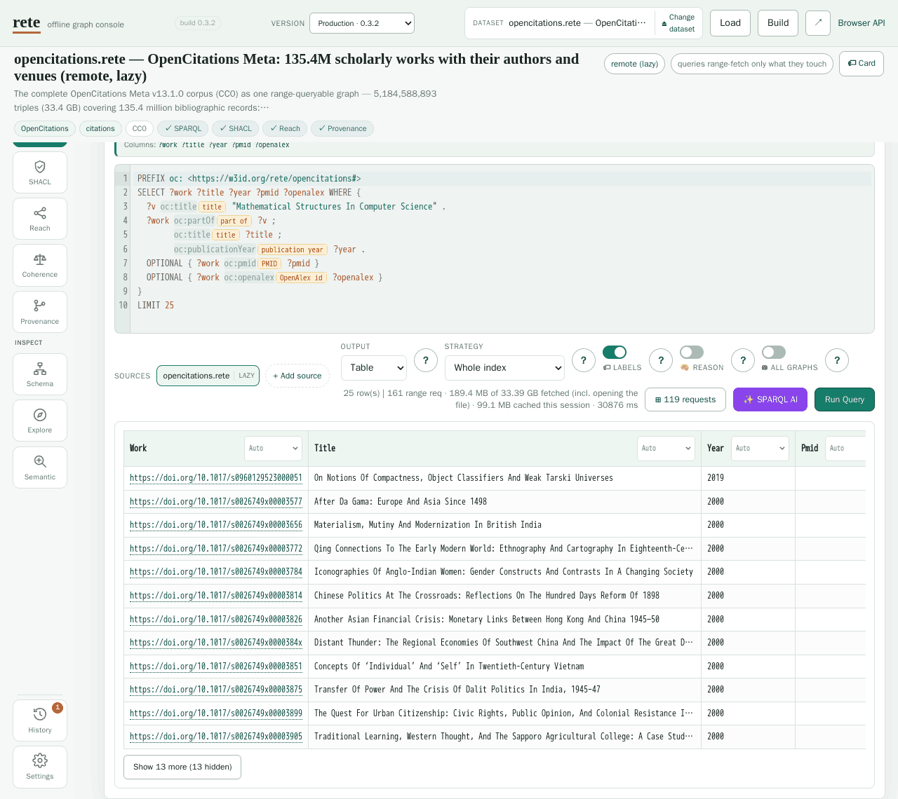

# The playground

[Launch the playground](playground.html) to open a graph, run an example query,
and see both its answer and the bytes needed to get it. The rete engine runs
in your browser. Embedded datasets work offline; remote datasets and optional
online resources still need a connection.

## Choose a dataset {#pick-a-dataset}

The picker groups datasets by theme and shows a description, licence and size.
Choose one whose example questions interest you. **Embedded** opens bytes
already in the page. **Lazy** reads a remote file as queries need it. **Cache**
downloads the whole file into IndexedDB for later local use; remove it under
**Settings > Whole-file caches**. A sharded dataset combines several files as
one logical graph, with queries fanning out across its shards.

Before querying an unfamiliar graph, open **Card** beside the source. The
[Dataset Card](dataset-cards.md) can tell you its title, licence, provenance,
counts, vocabulary and starter queries without reading the triple index.
**Use** loads a card query into the editor; these also appear beside catalog
examples. **JSON** lets you copy or download the card. The rendered view also
shows any separate build record. Older or cardless files may lack these fields.

To open your own file, use **+ Add source > Connect (lazy)** with a `.rete` URL.
Its host needs ranges and browser CORS; see [Hosting](hosting.md).

Chromium uses concurrent reads by default. Firefox and Safari default to
sequential reads because their engines can trap in the concurrent reader;
large remote queries may therefore take longer. Settings can force concurrent
reads, with that risk. Mobile memory limits can prevent very large graphs
from opening. The optional local AI and semantic-search models need WebGPU.

## Run a question you can interpret {#write-a-query}

Click an example query, read its tip, then run it. Start with the default
**Whole index** strategy so you are querying full data. The table columns
correspond to the variables selected by the query. IRIs identify resources;
labels help you read them, and media-aware cells can show pictures, documents,
models or geometry.

Change one part of the query and run it again. **Find a term** browses classes
and predicates, searches entities by label, and inserts an IRI at the cursor.
A predicate's **values >** drill shows its distinct objects. **Labels** adds
human-readable chips. **SPARQL AI** can draft a query locally on your GPU;
check the draft and its results against the question you intended.

Two controls change the meaning of a query:

- **Reason** includes solutions entailed through supported OWL 2 QL query
  rewriting. See [Reasoning](reasoning.md#reasoning-by-query-rewriting-owl-2-ql).
- **All graphs** treats the default graph as the union of default and named
  graphs. It can help when all statements are in named graphs, but it is
  nonstandard and can add substantial reads. It does not apply to federated
  runs or live endpoints. See [Union default graph](sparql.md#union-default-graph).

Choose an **Output** that fits the selected columns:

| Output | Needs | Query shape |
| --- | --- | --- |
| **Table** | anything | any `SELECT`, `ASK`, or `CONSTRUCT` |
| **Cards** | anything | the same rows as Table, but **one card per row** with the fields stacked — media renders full-width, so it reads well on a phone; on a wide screen the cards flow as a **masonry**. The **⚙ Fields** button picks how each field renders (the same types as a table column's header dropdown). |
| **Graph** | edges to draw | a `CONSTRUCT { ?a ?p ?b } …`, or a `SELECT` with **≥ 2 variables** — 2 vars are read as `v1 → v2` ("related") edges; **3 vars** are read as (subject, predicate, object). A 1-variable `SELECT` has nothing to connect. |
| **Map** | a WKT geometry column | a `SELECT` that binds a variable to a `geo:wktLiteral` (e.g. `?w` via `geo:hasGeometry/geo:asWKT ?w`). `POINT` / `LINESTRING` / `POLYGON` / `MULTI*` all plot; the first **non-geometry** column becomes each feature's hover label. |
| **Time** | a year / date column | a `SELECT` that binds a variable to `xsd:gYear`, `xsd:date` / `xsd:dateTime`, or a plain **year integer** (e.g. `ex:year ?y`). The other selected column(s) become the items listed in each cell's tooltip. |
| **TTL / JSON-LD** | triples | a `CONSTRUCT` query — these serialise the constructed graph. A `SELECT` has no triples to serialise. |

Map and Time detect geometry and dates in the returned columns. Time buckets
years to fit the span and recognizes negative years as BCE. The Map plot can
work offline; a dataset with PMTiles can also offer **Tiles**. Use Whole index
or Split by community for individual geometry and dates: **Progressive** uses
summary data and returns approximate answers. See [GeoSPARQL](geosparql.md)
and [Media & SQL companions](media-companions.md) for examples and media types.

## Read the cost, then explore further {#watching-the-bytes-and-the-caches}

On a remote graph the result line reports `N range requests / M KB fetched /
file is X MB`. These are bytes read, not a promise that every query reads a
small fraction. Open **requests** for the actual ranges. Run the query again:
`0 new bytes` means the session cache supplied its reads, even if query
computation still took time.

**Settings > Persist fetched ranges across reloads** keeps fetched blocks in
IndexedDB; whole-file caches are separate. The optional isolated **Parallel
range reads** worker pool reloads to enable isolation and disables CDN-loaded
DuckDB/SQLite backends while active. The default Chromium concurrent reader
does not require this setting.

The same source supports other ways to investigate it:

| Mode | What to do next |
| --- | --- |
| Schema | Browse classes and relations; see [Semantic zoom](semantic-zoom.md). |
| Explore | Browse entity tables by class, or SQL companions where supplied; see [Media & SQL companions](media-companions.md). |
| Semantic | Search by meaning on files with embeddings, turn hits into a SPARQL `VALUES` block, or draft a grounded answer; see [Ask the graph](ask-the-graph.md). |
| SHACL | Check shapes; see [SHACL validation](shacl.md). |
| Reach | Follow one predicate transitively from seed entities; see [CLI reachability](cli.md). |
| Provenance | Inspect the physical dictionary, index and tile ranges behind a match; see [Browser API](browser.md). |
| Coherence | Run tiered checks, from schema scans to materialization; see [Reasoning](reasoning.md). |

**Build** turns pasted or uploaded N-Triples, N-Quads or Turtle into a file you
can query, save in the browser or download. In step 3, the catalog entry controls
how the playground lists the graph; the separate Dataset Card JSON travels
inside the file. Form fields patch that JSON. The same engine validation as
`rete build --card-file` checks it; unknown fields belong in `extra`, and themes
must be IRIs. See [Dataset Cards](dataset-cards.md) for the full schema.

A browser build currently writes curated fields and measured counts, without
the derived profile, starter-query library or build record. An empty card editor
produces no card. Rebuild with the CLI for the full derived card and compressed
sections. The WASM API offers derived-card building, but this UI does not call
it. See [Getting started](getting-started.md) and [Hosting](hosting.md) to publish.

**+ Add source** also lets you query several files together, including
cross-source joins for flat basic graph patterns. Nested query shapes have
limits; read [Federation](federation.md#in-the-playground). A SPARQL endpoint
with **live** enabled becomes the query target and permits updates. Connected
to `rete serve`, this lets you edit the live graph and download a snapshot;
`#endpoint=<url>` opens an endpoint directly.

## Share the answer and its settings {#sharing}

Press **Share**, or use an example chip's link button. Catalog examples and
datasets have preview pages under `q/` and `d/` that open the corresponding
playground view. Their cards show measured answers and costs; browse
[Shareable queries](shared.html). Edited queries and views with extra settings
use a playground deep link instead.

The URL fragment records the dataset, query or example, and relevant controls.
Settings that change the answer must travel with it:

| Parameter | Control | Values | Effect |
| --- | --- | --- | --- |
| `union` | ⛁ **All graphs** | `1` / `0` (default off) | *answer* — mounts the file as if the default graph were the union of the default graph and every named graph |
| `reason` | 🧠 **Reason** | `1` / `0` (default off) | *answer* — OWL 2 QL entailment, so subclass/subproperty instances also match |
| `strategy` | **Strategy** | `whole` (default) · `progressive` · `community` | *answer* — `progressive` answers from the pyramid summary and is **approximate by contract** |
| `round` | **Round** | an integer | *answer* — which dendrogram round the `community` strategy answers from |
| `fed` | **SOURCES** | comma-separated catalog keys, e.g. `fed=nomisma,mimotext` | *answer* — extra datasets the query also runs against |
| `view` | **Output** | `table` (default) · `cards` · `graph` · `map` · `tiles` · `time` · `ttl` · `jsonld` | *presentation* — how the same rows are drawn |
| `labels` | 🏷 **Labels** | `1` (default on) / `0` | *presentation* — the human-label chips beside IRIs in the editor |

The first five controls change query results; `view` and `labels` change their
presentation. The address bar updates as you change them.

An external file uses `#url=<https://your-host.example/file.rete>&mode=sparql`. Catalog sources
added for federation can travel as `fed` keys, but **additional sources pasted
as URLs or endpoints are omitted**. Share warns when it leaves one out, so
check that warning before sending a link. A link cannot supply a recipient
with browser-local built data or private access to a source.

For embedding the engine in your own page, see the [Browser API](browser.md).
For source builds and playground generation, see [Contributing](contributing.md).
