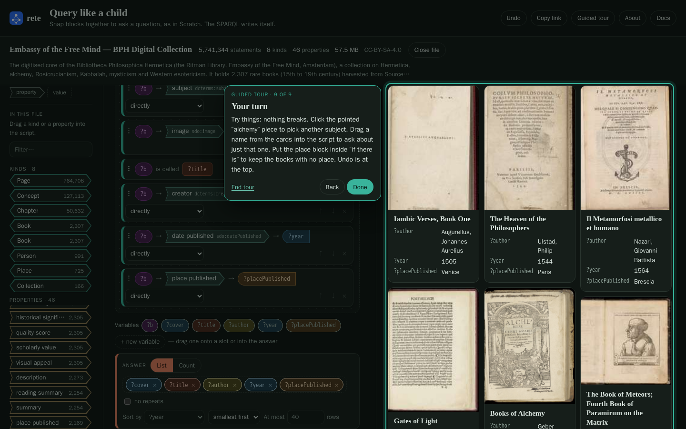

# Query like a child

[Open Query like a child](https://caviri.github.io/rete/query-like-a-child/) to
ask a graph a question by snapping blocks together. The SPARQL is written for
you as you go, and the answer appears beside it. The rete engine runs in your
browser.

The idea comes from [Scratch](https://scratch.mit.edu/), the block language
made for children: pieces have shapes, and a piece only fits where its shape
does. The page is not part of Scratch and is not affiliated with it.

## Open a file

The page works without a file: the blocks then offer common kinds and
properties, and you can read the SPARQL but not run it. To get answers, open a
graph in one of three ways:

- pick a sample: Linked Jazz, Hermetic books or Wikidata paintings;
- paste the URL of any `.rete` file, or add it to the address as
  `?rete=<url>`;
- choose a `.rete` file from your computer.

A remote file is read by range requests, so its host needs ranges and browser
CORS; see [Hosting](hosting.md). The page then lists the file's own kinds and
properties, with their names and how many statements use each. Those lists come
from the file's [Dataset Card](dataset-cards.md). A file without a card opens
and runs, but offers no lists.

## The pieces

Four shapes say what fits where:

| Shape | Stands for |
|---|---|
| Round | a thing |
| Pointed at both ends | a kind of thing |
| Arrow | a property |
| Square | a value, such as a name, a number or a date |

Point at a slot and the sidebar lights up the shape it takes, the block it
belongs to, and the kind or property it holds.

Blocks come in three groups:

| Group | Blocks |
|---|---|
| Find | is a kind of thing, is linked to, has a name, is exactly |
| Keep only | text contains, bigger or smaller, in a language, work out a value |
| Combine | if there is, but without, either / or |

Drag a block into the script. Drag a kind or a property from the sidebar onto
a slot, or click a slot to choose. An empty slot stands for a variable of its
own. To look for one particular thing, such as a person or a place, click a
slot and search the file's names.

Variables are listed under the script. Drag one onto another slot to say that
both are the same thing. **+ new variable** makes one before you need it.

## The answer

Under the script, **Answer** decides what comes back: which variables to show,
a list or a count, a count per something, the sort order, and how many rows.
The page shows at most 1,000 rows.

Results can be read three ways:

- **Table**: one row per answer.
- **Cards**: one card per row. A column of image links becomes the picture.
- **Graph**: the things and links the script found, drawn as a network.

**Copy as CONSTRUCT** gives the same script as a query that writes a graph.

## The SPARQL

The query under the script is the one that runs. Click it to edit. While the
blocks can express what you type, they are rebuilt from it. When they cannot,
your text runs as written and the blocks stay as they were.

The blocks cover a part of SPARQL: patterns, simple property paths, `OPTIONAL`,
`UNION`, `FILTER NOT EXISTS`, the filters above, `BIND` with a few functions,
`COUNT` with `GROUP BY`, one `ORDER BY`, and `LIMIT`. Anything else is for the
text box, or for the [playground](playground-guide.md) and the
[SPARQL IDE](yasgui-guide.md).

## Examples and the tour

**Examples** holds seventeen common questions that work on any file, such as
"How many of each kind" or "Things missing something". When a file's card
brings its own example queries, they are listed too, and open as blocks where
the blocks can express them.

**Guided tour** walks through one question on the Hermetic books file: books on
alchemy with their covers, to which you add the place each was published.

**Copy link** puts the script in the address, so a link reopens the same
question. **Undo** steps back.
